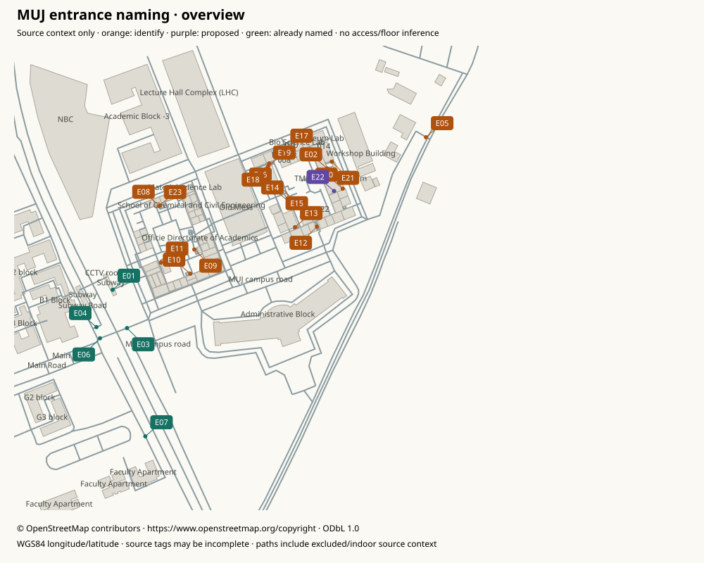

# MUJ entrance identification atlas

Source-derived OSM context, not an official map or survey. Numbering is stable for this pinned source. Gray footprints/paths can include quarantined indoor or inaccessible source data; map context does not create routing connections. Open each detail image at full size for surrounding labels. North is up.

[Overview](overview.svg) · [Full inventory CSV](inventory.csv) · [Evidence JSON](../../../data/muj-naming/inventory.json)

|Marker|Current name / source node|Proposed name / action|Source evidence|
|---|---|---|---|
|[E01](E01.svg)|Subway entrance/exit (`osm-node-10733816254`)|Subway entrance/exit|way 1154145270: Subway road; way 1154145273: Subway Stairs|
|[E02](E02.svg)|Mapped entrance 10773902923 (`osm-node-10773902923`)|**Identify; unresolved.** Do not infer a building from this map.|way 1158509500: AB2 Corridor; way 1249393737: TMA Pai Auditorium; way 1249393738: path; way 1254788415: 016|
|[E03](E03.svg)|University Entrance (`osm-node-10780185180`)|University Entrance|way 1159217178: service; way 1245026708: tertiary|
|[E04](E04.svg)|Hostel Entrance (`osm-node-10780185181`)|Hostel Entrance|way 1244943100: path; way 1245274147: path|
|[E05](E05.svg)|Mapped entrance 10828149259 (`osm-node-10828149259`)|**Identify; unresolved.** Do not infer a building from this map.|way 926460863: service|
|[E06](E06.svg)|GHS Entrance (`osm-node-11573265515`)|GHS Entrance|way 1158554635: Manipal University Jaipur; way 1245026709: tertiary; way 1245026710: service|
|[E07](E07.svg)|Faculty Block Entrance (`osm-node-11573972967`)|Faculty Block Entrance|way 1245026714: path; way 1365893470: G5 road|
|[E08](E08.svg)|Mapped entrance 11593739317 (`osm-node-11593739317`)|**Identify; unresolved.** Do not infer a building from this map.|way 1245556383: steps; way 1271670518: path|
|[E09](E09.svg)|Mapped entrance 11594245182 (`osm-node-11594245182`)|**Identify; unresolved.** Do not infer a building from this map.|way 1247150898: steps; way 1247150899: path|
|[E10](E10.svg)|Mapped entrance 11594245187 (`osm-node-11594245187`)|**Identify; unresolved.** Do not infer a building from this map.|way 1245556384: steps; way 1247150900: footway|
|[E11](E11.svg)|Mapped entrance 11598364403 (`osm-node-11598364403`)|**Identify; unresolved.** Do not infer a building from this map.|way 1247657280: steps|
|[E12](E12.svg)|Mapped entrance 11612768365 (`osm-node-11612768365`)|**Identify; unresolved.** Do not infer a building from this map.|way 1249398694: steps; way 1249398695: path|
|[E13](E13.svg)|Mapped entrance 11612773070 (`osm-node-11612773070`)|**Identify; unresolved.** Do not infer a building from this map.|way 1249398696: steps; way 1249398697: path|
|[E14](E14.svg)|Mapped entrance 11612773094 (`osm-node-11612773094`)|**Identify; unresolved.** Do not infer a building from this map.|way 1249398704: steps; way 1249398711: path|
|[E15](E15.svg)|Mapped entrance 11612773101 (`osm-node-11612773101`)|**Identify; unresolved.** Do not infer a building from this map.|way 1249398705: steps; way 1249398708: path|
|[E16](E16.svg)|Mapped entrance 11612773115 (`osm-node-11612773115`)|**Identify; unresolved.** Do not infer a building from this map.|way 1249398706: yes; way 1249398708: path|
|[E17](E17.svg)|Mapped entrance 11664524151 (`osm-node-11664524151`)|**Identify; unresolved.** Do not infer a building from this map.|way 1254788396: steps; way 1254788397: path|
|[E18](E18.svg)|Mapped entrance 11664524161 (`osm-node-11664524161`)|**Identify; unresolved.** Do not infer a building from this map.|way 1254788402: steps; way 1254788403: path|
|[E19](E19.svg)|Mapped entrance 11664524167 (`osm-node-11664524167`)|**Identify; unresolved.** Do not infer a building from this map.|way 1249398706: yes; way 1254788404: path|
|[E20](E20.svg)|Mapped entrance 11664524384 (`osm-node-11664524384`)|**Identify; unresolved.** Do not infer a building from this map.|way 1254788411: steps; way 1254788412: path|
|[E21](E21.svg)|Mapped entrance 11664524402 (`osm-node-11664524402`)|**Identify; unresolved.** Do not infer a building from this map.|way 1254788417: steps; way 1254788418: path|
|[E22](E22.svg)|Mapped entrance 11664524407 (`osm-node-11664524407`)|TMA Pai Auditorium entrance|way 1249393737: TMA Pai Auditorium; way 1254788420: path|
|[E23](E23.svg)|Mapped entrance 11809063446 (`osm-node-11809063446`)|**Identify; unresolved.** Do not infer a building from this map.|way 1245556383: steps; way 1247085147: path|

## Owner response

For each unresolved marker, return `E## — confirmed public entrance name — how you know — any uncertainty`. Say “unknown” if unsure. Identify the specific door/gate, not just a nearby building. E05 is the current 513m/799m route destination and has no source building association. E02 belongs to both a named auditorium outline and room016 outline; exclusive identity is ambiguous. E08/E23 and their adjacent nodes retain the separately documented near-duplicate/floor ambiguity. E16/E22 carry source main tags, which do not establish an institutional main entrance. E22 alone has unique named building-outline membership; proposed wording omits main. No guessed rename is enabled.

